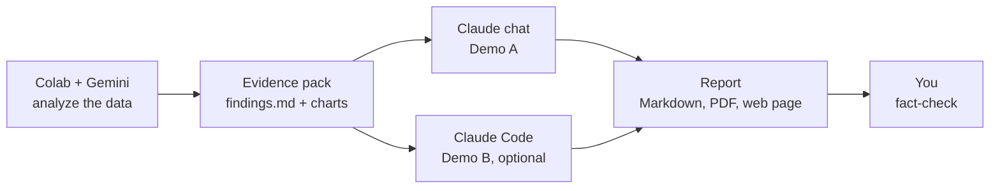

<div align="center">

<a href="https://www.lib.ncsu.edu/" aria-label="nc state university libraries logo"></a>

<h2>NC State University Libraries Python Workshops</h2>

<a href="https://www.lib.ncsu.edu/workshops"></a>
<a href="https://www.lib.ncsu.edu/staff/department/data-science-services"></a>
<a href="https://go.ncsu.edu/getdatahelp"></a>
<a href="mailto:getdatahelp@ncsu.edu"></a>
<br/>

</div>

# ISE498 Workshop: AI-Assisted Analysis and Reporting

- [Back to repository overview](../../README.md)

Analyze two weeks of engine production data in Google Colab with Gemini, package the results as an
**evidence pack**, and have Claude turn it into a formatted report (Markdown, PDF or a web page) that you
fact-check before anyone reads it.

## 🧭 Workflow



**The one rule:** the report may only use numbers that code computed. Gemini helps write the analysis, a
notebook cell packages the results, and Claude writes from that package.

## 📓 Materials

### Part 1: Analyze with Gemini in Colab

[](https://colab.research.google.com/github/NCSU-Libraries/ai_in_data_science/blob/main/workshops/ise498/engine_production_gemini.ipynb)

**`engine_production_gemini.ipynb`**: the participant notebook, with:
- Ready-to-paste prompts for Gemini at every step
- ✅ Checkpoints for verifying what Gemini produces
- A catch-up cell, so nobody falls behind
- A one-click evidence-pack builder (`findings.md` + three report-ready charts)

[](https://colab.research.google.com/github/NCSU-Libraries/ai_in_data_science/blob/main/workshops/ise498/engine_production_gemini_filled.ipynb)

**`engine_production_gemini_filled.ipynb`**: the reference version, with every cell filled in and run.

### Part 2: Write the Report with Claude

**[`report_with_claude.md`](report_with_claude.md)** covers:
- **Demo A, Claude chat** (everyone): upload the pack, paste the report brief, audit the result, then get
  Markdown, a PDF and an optional web page
- **Demo B, Claude Code** (optional): the same brief run as an agent, which writes `report.md`, audits it,
  builds `report.pdf` and creates a Vite web page
- A fact-check checklist

### For Instructors

- **[`facilitator_guide.md`](facilitator_guide.md)**: 60-minute run sheet, answer key, coaching tips and fallbacks
- **[`example_outputs/`](example_outputs/)**: a complete run (the evidence pack, then Claude's report, audit,
  PDF and Vite page)

## ⏱️ Agenda (60 Minutes)

| Time | Part |
|---|---|
| 0-5 min | Intro: the workflow and the one rule |
| 5-39 min | Part 1: Steps 0-6 in Colab with Gemini |
| 39-56 min | Part 2: Demo A (claude.ai), then Demo B (Claude Code, optional) |
| 56-60 min | Wrap-up |

## ✅ Before You Come

- A laptop with an up-to-date browser
- A Google account (18+) that can use Gemini in Colab: open any notebook in
  [Colab](https://colab.research.google.com) and look for the **Gemini** spark icon (✦) at the bottom.
  School-managed accounts may have it turned off; a personal Google account works as a backup.
- A Claude account at [claude.ai](https://claude.ai) (the Free plan works)
- Optional, for Demo B only: [Claude Code](https://code.claude.com/docs/en/setup) (needs a paid plan or an
  API account) and [Node.js](https://nodejs.org/) 22 or newer

## 📚 Dataset Information

- **Source file**: `data/engine_production_data_original.csv` (the same data as the
  [Engine Production workshop](../engine_production/README.md))
- **Format**: CSV, 1,018 hourly records: three machines, three shifts, October 21 to November 4, 2024
- **Primary fields**: `Timestamp`, `Shift`, `Day_of_Week`, `Machine_ID`, `Model_Type`, `Production_Count`,
  `Defective_Count`, `Downtime_Min`
- **Intentional data issues** for the trust check: duplicate rows, inconsistent labels, an unknown machine ID,
  text in a numeric column and impossible values

## 🚀 Quick Start

### Option 1: Open in Google Colab (Recommended)
Click the first "Open In Colab" badge above, then choose **File → Save a copy in Drive**.

### Option 2: Local Setup
1. Clone this repository:
	```bash
	git clone https://github.com/NCSU-Libraries/ai_in_data_science.git
	cd ai_in_data_science
	```

2. Install required packages:
	```bash
	pip install -r requirements.txt
	```

3. Launch Jupyter:
	```bash
	jupyter notebook workshops/ise498/engine_production_gemini.ipynb
	```

Gemini is built into Colab only. When running locally, paste the prompts into any AI assistant instead.

## 📄 License

This project is licensed under the MIT License - see the [LICENSE](../../LICENSE) file for details.
