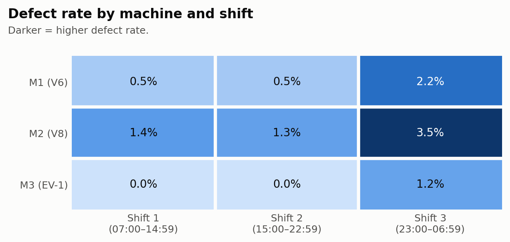
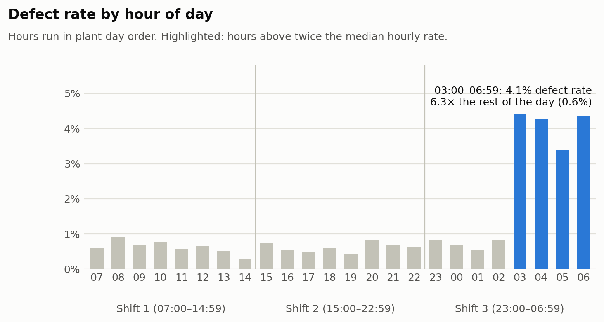
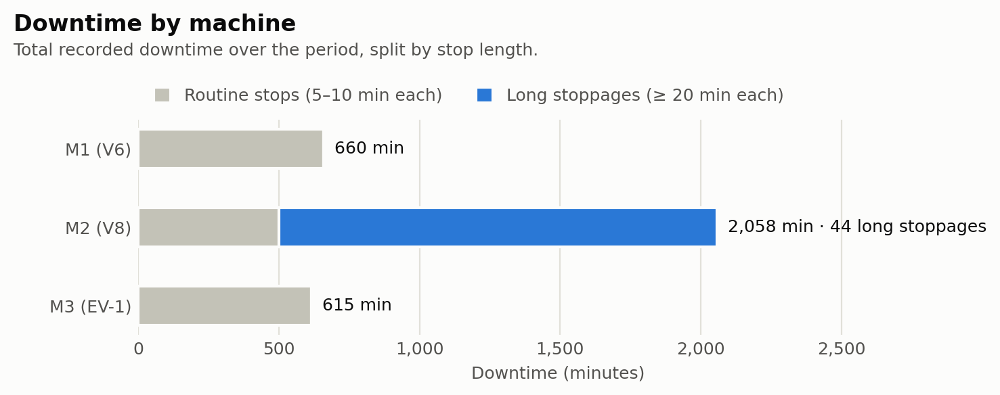

# Engine Plant Operations Report: Night-Shift Defects and M2 Downtime

*Period: Oct 21 to Nov 4, 2024 (14 plant days) · Source: hourly production log (engine_production_data_original.csv), cleaned by code*

## Executive summary

- **Defects peak at the end of the night shift.** From 03:00 to 06:59 the defect rate is **6.3 times** the rate in all other hours, and every machine shows the jump.
- **Downtime is concentrated on M2 (V8).** M2 accounts for **61.7%** of all recorded downtime, driven by long stoppages that never occurred on M1 or M3.
- **M2's long stoppages cost output.** They cost an estimated **865 engines**; with no reason codes and only one model per machine, we cannot yet tell whether the machine or the V8 is to blame.

## What we analyzed

We analyzed the hourly production log for M1 (builds the V6), M2 (V8) and M3 (EV-1) from Oct 21 to Nov 4, 2024; each record is one machine-hour (one machine running for one hour). Cleaning removed duplicates, fixed labels and machine IDs, and dropped impossible rows, leaving 1,002 machine-hours and 36,888 engines. Missing values were kept as missing, not counted as zero.

## Findings

### 1. Quality loss is mainly a Shift 3 (night) problem, on every machine

- Shift 3 (23:00–06:59) made **65.8%** of all defective engines (289 of 439).
- Its defect rate was **2.39%**, against 0.63% on Shift 1 and 0.62% on Shift 2. *Defect rate = defective engines as a share of engines built.*
- Every machine is worst on Shift 3 (M1 2.24%, M2 3.48%, M3 1.23%). M2 (V8) has the highest rate overall (2.06%) and in every shift.
- The gap between shifts is statistically significant (Kruskal-Wallis test, p < 0.001). *In plain terms: a gap this large is very unlikely to be chance.*

**So what:** Because every machine gets worse at night, the cause is more likely in how Shift 3 runs than in any one machine.

### 2. The spike sits at 03:00–06:59, the end of Shift 3

- Shift 3 starts normally; the rate jumps at 03:00 and stays high until the shift ends.
- This window is 4 of 24 hours (16.7% of the day) but produced **245 of 439 defects (55.8%)**.
- Its defect rate is **4.09%**, versus 0.65% in all other hours: 6.3 times higher.
- That is about 206 more defects than the rest-of-day rate would predict (an estimate).
- The jump shows on every machine: M1 3.89% (vs 0.53% in other hours), M2 5.74% (vs 1.32%), M3 2.39% (vs 0.00%).
- Shift 3 was the worst shift on 14 of 14 plant days: a steady pattern, not a few bad nights.

**So what:** The 03:00–06:59 window is the clearest route to fewer defects; fatigue or end-of-shift practices are worth checking first.

### 3. Downtime is concentrated on M2 (V8), driven by long stoppages

- M2 recorded 2,058 of 3,333 downtime minutes (**61.7%**); M1 had 660 and M3 615.
- All 44 long stoppages (20–58 min each) were on M2, on 14 of 14 plant days, adding up to 1,558 min (46.7% of all downtime).
- During long-stoppage hours M2 built 19.5 engines per hour, versus 39.1 in its other hours: an estimated **865 engines** lost (7.1% of M2's actual output).
- M2 is the only machine that builds the V8, so the cause could be the machine or the model; the data cannot separate them.

**So what:** M2's long stoppages are the clearest downtime target; its maintenance records are the first place to look for the cause.

## Recommendations

| Action | Evidence | Suggested owner (role) | First step this week | Success metric |
|---|---|---|---|---|
| Find out why defects spike from 03:00 to 06:59 | 4.09% defect rate vs 0.65% in other hours; 55.8% of all defects | Shift 3 supervisor, with the quality engineer | Observe the line from 03:00 to 06:59 and review staffing, breaks, handover and inspection routines in that window | Defect rate from 03:00 to 06:59 moves toward the 0.65% of other hours |
| Find the cause of M2's long stoppages | 44 long stoppages, all on M2; 61.7% of downtime; about 865 engines lost | Maintenance lead | Match M2's maintenance and repair records to the 44 long stoppages | Fewer than 44 long stoppages on M2 over a comparable 14 plant days |
| Separate machine effects from V8 effects | Each machine builds only one model, so the data cannot tell them apart | Production planner or manufacturing engineer | Check whether a short V8 run on another machine, or another model on M2, is feasible | A clear answer on whether M2's problems follow the machine or the V8 |
| Record a reason for every stop and defect | No downtime reason codes or defect types in the data | Production manager, with whoever maintains the production log | Add "stop reason" and "defect type" fields to the hourly log | Every stop and defect has a recorded reason |

## Limitations

- **Machine and model cannot be separated.** Each machine builds exactly one model (M1 = V6, M2 = V8, M3 = EV-1), so any "M2" result may equally be a "V8" result.
- **Short window.** The data covers 14 plant days; longer-term or seasonal patterns are not visible.
- **No causes in the data.** There are no downtime reason codes, defect types, staffing or maintenance records, so every cause here is a hypothesis.
- **Missing values.** 24 defect counts and 24 downtime values are missing (see the appendix).
- **Estimates.** Engines lost (about 865) and excess defects (about 206) are estimates, not counts.

## Appendix: data cleaning log

- Removed 10 exact duplicate rows (1,018 → 1,008 rows).
- Standardized 50 abbreviated day names and 17 lowercase model labels.
- Reassigned 3 rows with the unknown machine ID "M99" using the one-model-per-machine rule (V6 → M1, V8 → M2, EV-1 → M3).
- Converted downtime to numbers; 5 text entries ("Maintenance") became missing because their duration is unknown.
- Dropped 6 impossible rows: negative production, or more defects than engines produced (1,008 → 1,002 rows).
- Kept missing values as missing, not zero: 24 defect counts and 24 downtime values. Rates and totals use only rows where the value is known.

## Notes for the analyst

- **Takeaway 3** calls downtime "a machine problem". Section 10 says machine and model effects cannot be separated, so the report says "concentrated on M2 (V8)".
- **Takeaway 4** says M2 maintenance records "should settle it". They can show whether the stoppages are equipment faults, but cannot alone separate machine from model effects (for example, for M2's defect rate), so the report calls them a first check.
- **Takeaway 1** uses rounded figures ("about two-thirds", "about 0.6%"); the report uses the computed 65.8%, 0.63% and 0.62% instead.
